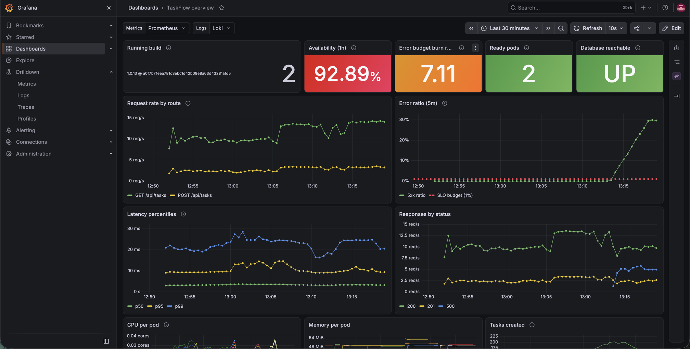
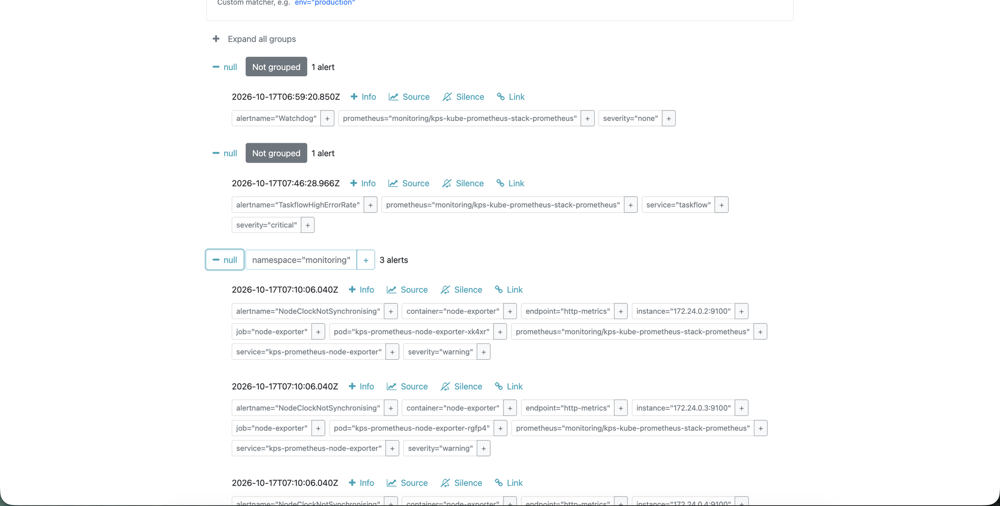
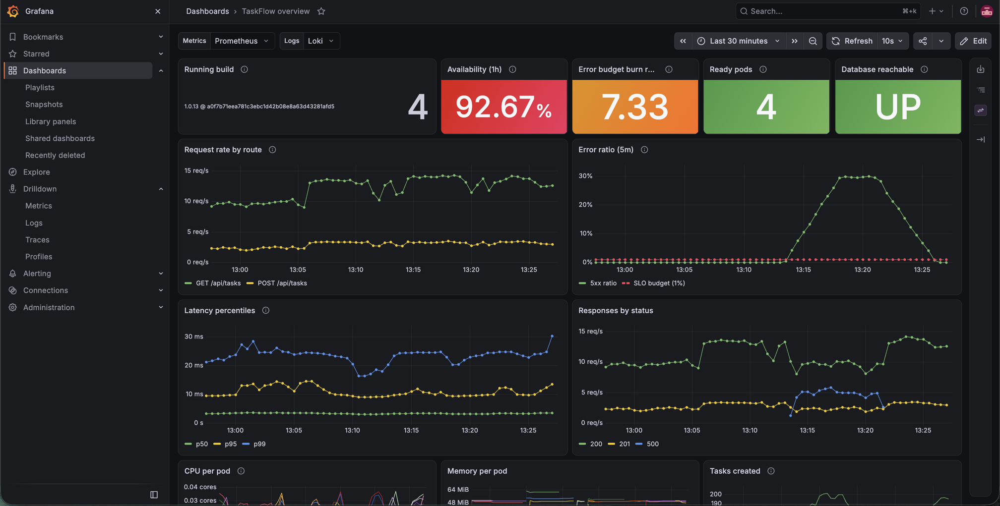
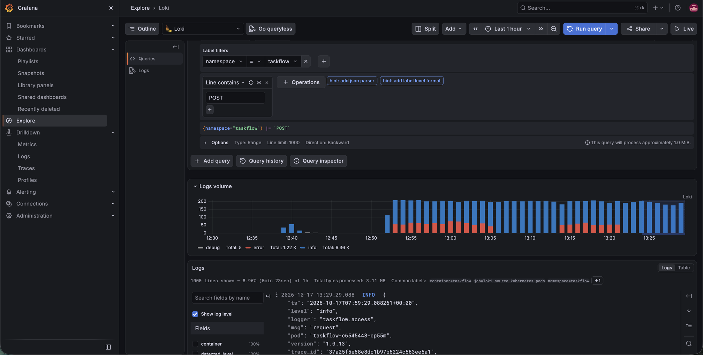
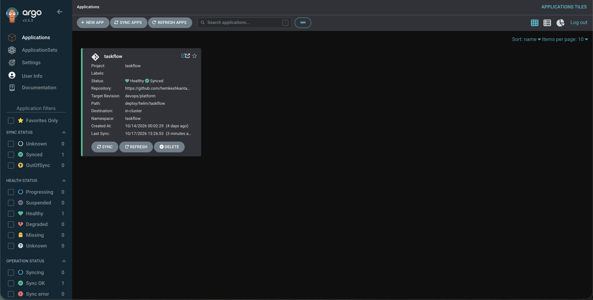

# TaskFlow: DevOps project report

TaskFlow, a small FastAPI and PostgreSQL task list, now builds, tests, scans, releases and
observes itself on Kubernetes. Everything below was run and checked on a live cluster.
How to run it yourself is in [Running it](#running-it).

## Submission at a glance

| Item | Value |
| --- | --- |
| Baseline commit (before DevOps work) | [`8b2761aacc2bc0daa1d37e4909c68ec9954dbaa7`](https://github.com/hemkeshkantawala11/taskflow/commit/8b2761aacc2bc0daa1d37e4909c68ec9954dbaa7) on `main` |
| Pull request (all improvements, unmerged) | [#1: main ← devops/platform](https://github.com/hemkeshkantawala11/taskflow/pull/1) |
| Deployed version | Release 6: source `a0f7b71`, pipeline run [39014215134](https://github.com/hemkeshkantawala11/taskflow/actions/runs/39014215134), release commit `7cce9cb` |

## What was done

1. **Containerised and tested the app:** health, readiness and version endpoints, metrics,
   JSON logs and tracing; 15 tests against real PostgreSQL; a multi-stage, non-root,
   multi-arch Docker image.
2. **Deployed on Kubernetes (kind) with a Helm chart:** zero-downtime rolling updates,
   autoscaling 2–5 pods, a PostgreSQL StatefulSet with persistent storage, NetworkPolicies
   and restricted Pod Security.
3. **CI/CD pipeline in GitHub Actions:** lint, tests and security scans (gitleaks,
   pip-audit, Trivy), a manual approval gate, then GitOps releases through Argo CD, with
   rollback by `git revert`.
4. **Observability:** Prometheus metrics with a 99% SLO and burn-rate alerts, a Grafana
   dashboard, logs in Loki and traces in Jaeger, linked by trace ID.
5. **Verified on a running cluster:** 6 releases with zero failed requests; alert, rollback,
   database-crash, drift and autoscaling demos.

## The application and the baseline

TaskFlow is a shared to-do list: add a task, mark it done, delete it. It is a Python 3.12
FastAPI service with a PostgreSQL 16 database and a plain HTML/JS page, exposing
`/api/tasks` (GET, POST) and `/api/tasks/{id}` (PATCH, DELETE).

At the baseline it had no DevOps setup. It ran by hand with `uvicorn` against a manually
started PostgreSQL, configured by one `DATABASE_URL` variable with a hard-coded default.
There was no container image, no tests, no CI/CD, no Kubernetes manifests, no health checks,
no metrics, no structured logging, no tracing and no security scanning.

The app was changed only where operation needed it: settings from environment variables, a
connection pool, `/healthz` (liveness, never touches the database), `/readyz` (readiness,
checks the database), `/version` (git SHA and pod name), `/metrics`, JSON logs carrying trace
IDs, OpenTelemetry tracing, a bounded list endpoint, and 15 tests against a real PostgreSQL.

## Architecture


A push is tested, scanned and built in GitHub Actions, the image goes to GHCR, and after a
human approval a bot commits the new tag to Git. Argo CD inside the cluster pulls that commit
and applies it; CI never holds cluster credentials. User requests flow Browser → Traefik →
web pods → PostgreSQL, and every pod emits metrics, logs and traces that Grafana reads in one
place.

## What was built

| Area | What is in place | Why it matters |
| --- | --- | --- |
| Kubernetes | Helm chart: web Deployment with startup, liveness and readiness probes; rolling update with `maxSurge: 1`, `maxUnavailable: 0`, `minReadySeconds: 5`, `preStop` sleep; HPA 2–5 pods at 70% CPU; PDB `minAvailable: 1`; topology spread; PostgreSQL StatefulSet with a 1Gi PVC; Traefik Ingress | Releases never drop capacity; a failing release stops at one pod; data survives pod loss |
| CI | GitHub Actions: ruff + pytest against PostgreSQL, gitleaks over full history, pip-audit, Trivy config scan, helm lint, kubeconform, promtool unit tests of the alert rules, Trivy image scan, container smoke test that checks `/version` returns the commit SHA | Every change is tested, scanned and validated before an image exists |
| CD and release control | Image tag = full git SHA (multi-arch amd64 + arm64) → manual approval on GitHub Environment `local` → bot commits the tag to `values-local.yaml` → Argo CD syncs with selfHeal and prune. Rollback = `git revert` | CI holds no cluster credentials; Git records every release and rollback |
| Observability | Prometheus RED metrics labelled by route template; 99% availability SLO with multi-window burn-rate alerts and runbook links; Grafana dashboard; JSON logs in Loki via Alloy; OpenTelemetry traces with SQL spans in Jaeger; trace ID links logs to traces | A failure is seen as a symptom, traced to a request, and alerted on against a budget |
| Security | Non-root UID 10001, read-only root filesystem, Pod Security "restricted", default-deny NetworkPolicies with explicit allows, no service account token, passwords generated in-cluster (never in Git), actions pinned to commit SHAs, checksum-verified tools | Small blast radius and a supply chain that cannot be silently swapped |
| Configuration | One chart, `values.yaml` defaults + `values-local.yaml` per environment; ConfigMap checksum triggers a restart; pinned platform versions in `deploy/platform/versions.env` | One source of truth, reviewable changes, no drifting copies |

## Screenshots



*Grafana during the error demo: availability falls, the error budget burns 7.1× too fast.*



*`TaskflowHighErrorRate` firing in Alertmanager (critical).*



*The same dashboard over 30 minutes: error spike and recovery.*



*Request logs in Loki as JSON, each with a `trace_id`.*



*Argo CD: application `taskflow` Synced and Healthy.*

## Key decisions

| Decision | Chosen | Alternative and when it would win |
| --- | --- | --- |
| Delivery | Pull-based GitOps with Argo CD; CI has no cluster credentials | Self-hosted runner doing `helm upgrade`: simpler, but CI needs cluster admin |
| Release strategy | Rolling update, `maxUnavailable: 0` | Canary with Argo Rollouts and metric analysis once users are real; blue-green for instant switch-back at 2× resources |
| Release gate | Manual approval before release only; all checks automatic | Remove the gate for continuous deployment once coverage and canary analysis are trusted |
| Liveness | Never checks the database | Checking it would restart every web pod during a database outage without fixing anything |
| Resources | Memory limits, no CPU limits | CPU limits cause throttling; requests already drive scheduling and the HPA |
| Secrets | Generated in-cluster by script, never in Git | Sealed Secrets or a vault for encrypted, auditable secrets |
| Image architectures | amd64 scanned and smoke-tested, arm64 added under QEMU | Native arm runners per architecture plus a manifest merge |


---

# Running it

| | |
|---|---|
| App | Python 3.12, FastAPI, PostgreSQL 16, plain HTML/JS front end |
| Runtime | Kubernetes (kind, 1 control plane + 2 workers), Helm chart, Traefik ingress |
| Delivery | GitHub Actions → GHCR → Git commit of the image tag → Argo CD |
| Signals | Prometheus + Grafana + Alertmanager, Loki + Alloy (logs), Jaeger (traces) |
| Security | Pinned actions, gitleaks, pip-audit, Trivy, restricted Pod Security, NetworkPolicies, secrets outside Git |

## Repository layout

```
app/                      FastAPI app (config, db pool, observability, UI)
tests/                    API + operational tests (run against real Postgres)
Dockerfile                multi-stage, non-root image with build metadata
.github/workflows/        CI/CD pipeline
deploy/helm/taskflow/     Helm chart: values.yaml (defaults) + values-local.yaml (environment)
deploy/argocd/            Argo CD AppProject + Application (GitOps)
deploy/platform/          Platform components (pinned versions in versions.env)
deploy/kind/              Local cluster definition
deploy/tests/             promtool unit tests for the SLO alerts
scripts/                  setup, secrets, smoke test, verification, failure demos
docs/                     runbook (linked from every alert) and screenshots
```

## Prerequisites

- Docker (Desktop or Engine) with **at least 8 GB RAM and 4 CPUs** allocated
- [kind](https://kind.sigs.k8s.io/) v0.33+, kubectl, Helm 3.x or 4.x, git, make, curl, openssl, python3
- A **public** GitHub repository (GHCR pulls, Argo CD access and environment approvals work without extra setup)

Tested end to end on macOS (Apple Silicon, arm64) with Docker Desktop 29.3, kind v0.33.0
(Kubernetes v1.37), Helm v4.3.0 locally and v3.21.4 in CI. The image is multi-arch
(amd64 + arm64), so Intel/Linux hosts work too.

> **Using kubectl for other clusters too?** The `make` targets and scripts act on your
> *current* kubectl context. Check `kubectl config current-context` says `kind-taskflow`
> first, or run them with an isolated config:
> `kind get kubeconfig --name taskflow > /tmp/kind.kubeconfig && export KUBECONFIG=/tmp/kind.kubeconfig`.

## Run it

### 1. One-time GitHub settings

1. **Settings → Environments → New environment** named `local`. Add yourself under
   **Required reviewers**. This is the manual release approval.
2. **Settings → Actions → General → Workflow permissions**: "Read and write".
   (The workflow still limits each job to what it needs.)
3. After the first pipeline run, check **your profile → Packages → taskflow** is
   **Public** (it was public automatically for this public repo), so the cluster can pull
   the image without credentials.
   (Private alternative: see the pull-secret note printed by `scripts/create-secrets.sh`.)

### 2. Create the cluster and platform (~10 minutes)

```bash
make cluster
```

This creates the kind cluster, generates secrets inside it, installs Traefik,
metrics-server, kube-prometheus-stack, Loki, Alloy, Jaeger and Argo CD, and
registers the TaskFlow application with Argo CD.

### 3. First release

```bash
git commit --allow-empty -m "ci: first release" && git push
```

In **Actions**, the run tests, scans and builds the image, then waits at the
**deploy** job: click **Review deployments → Approve**. The job commits the new
image tag to `deploy/helm/taskflow/values-local.yaml`. Argo CD picks it up within
a minute (`make sync` to force it), then:

```bash
git pull --rebase    # fetch the release bot's commit before your next push
make status
make smoke
```

Open **http://taskflow.localtest.me:8080**. The strip at the bottom shows the
running git SHA and which pod answered.

### 4. Look at the signals

```bash
make ui                 # port-forwards everything; leave it running
make grafana-password   # in another terminal
make load               # traffic so the graphs move
```

| Tool | URL | Login |
|---|---|---|
| Grafana (dashboard "TaskFlow overview") | http://localhost:3000 | `admin` / `make grafana-password` |
| Argo CD | http://localhost:8081 | `admin` / `make argocd-password` |
| Prometheus | http://localhost:9090 | none |
| Alertmanager | http://localhost:9093 | none |
| Jaeger | http://localhost:16686 | none |

Logs: Grafana → Explore → Loki → `{namespace="taskflow"} | json`. Click a `TraceID`
in a log line to open that request's trace.

### 5. Collect evidence

```bash
make verify     # writes evidence/verification-<timestamp>.md
```

## Everyday workflow

| Goal | Command |
|---|---|
| Change code and release it | commit, `git push`, approve the deploy job, `git pull --rebase` |
| See what's running | `make status` |
| Roll back a bad release | `make rollback` (reverts the newest deploy commit; Argo CD applies it) |
| Run the app without Kubernetes | `make dev` → http://localhost:8000 |
| Run tests locally | `docker compose up -d db && make test` |
| Failure demos | `make demo-drift`, `demo-db`, `demo-bad-release`, `demo-errors-on/off` |
| Remove everything | `make clean` |
