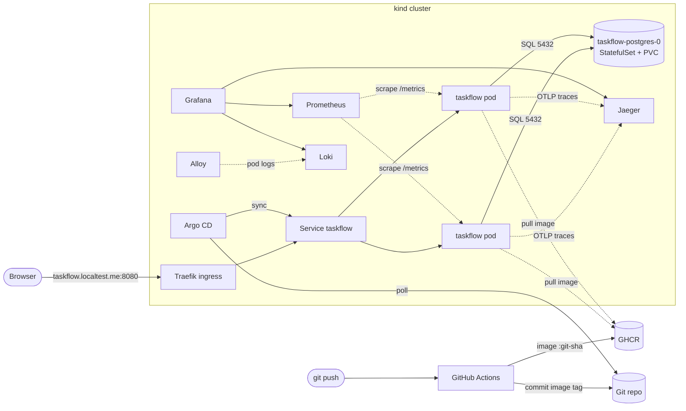

# TaskFlow

A small shared task list (add, complete, delete tasks), built with FastAPI and
PostgreSQL, and operated on Kubernetes with a complete delivery and observability
setup: CI with security gates, GitOps releases through Argo CD, SLO-based
alerting, logs, metrics and traces.

| | |
|---|---|
| App | Python 3.12, FastAPI, PostgreSQL 16, plain HTML/JS front end |
| Runtime | Kubernetes (kind, 1 control plane + 2 workers), Helm chart, Traefik ingress |
| Delivery | GitHub Actions → GHCR → Git commit of the image tag → Argo CD |
| Signals | Prometheus + Grafana + Alertmanager, Loki + Alloy (logs), Jaeger (traces) |
| Security | Pinned actions, gitleaks, pip-audit, Trivy, restricted Pod Security, NetworkPolicies, secrets outside Git |

## Architecture



Details: [docs/architecture.md](docs/architecture.md), design choices: [docs/decisions.md](docs/decisions.md).

## Repository layout

```
app/                      FastAPI app (config, db pool, observability, UI)
tests/                    API + operational tests (run against real Postgres)
Dockerfile                multi-stage, non-root image with build metadata
.github/workflows/        CI/CD pipeline
deploy/helm/taskflow/     Helm chart: values.yaml (defaults) + values-local.yaml (environment)
deploy/argocd/            Argo CD AppProject + Application (GitOps)
deploy/platform/          Platform components (pinned versions in versions.env)
deploy/kind/              Local cluster definition
deploy/tests/             promtool unit tests for the SLO alerts
scripts/                  setup, secrets, smoke test, verification, failure demos
docs/                     architecture, decisions, runbook, fault demo, evidence
```

## Prerequisites

- Docker (Desktop or Engine) with **at least 8 GB RAM and 4 CPUs** allocated
- [kind](https://kind.sigs.k8s.io/) v0.33+, kubectl, Helm 3.x or 4.x, git, make, curl, openssl, python3
- A **public** GitHub repository (GHCR pulls, Argo CD access and environment approvals work without extra setup)

Tested configuration: kind v0.33.0, Helm v3.21.4. Linux, macOS or Windows (WSL2).

## Run it

### 1. One-time GitHub settings

1. **Settings → Environments → New environment** named `local`. Add yourself under
   **Required reviewers**. This is the manual release approval.
2. **Settings → Actions → General → Workflow permissions**: "Read and write".
   (The workflow still limits each job to what it needs.)
3. After the first pipeline run: **your profile → Packages → taskflow → Package settings
   → Change visibility → Public**, so the cluster can pull the image without credentials.
   (Private alternative: see the pull-secret note printed by `scripts/create-secrets.sh`.)

### 2. Create the cluster and platform (~10 minutes)

```bash
make cluster
```

This creates the kind cluster, generates secrets inside it, installs Traefik,
metrics-server, kube-prometheus-stack, Loki, Alloy, Jaeger and Argo CD, and
registers the TaskFlow application with Argo CD.

### 3. First release

```bash
git commit --allow-empty -m "ci: first release" && git push
```

In **Actions**, the run tests, scans and builds the image, then waits at the
**deploy** job: click **Review deployments → Approve**. The job commits the new
image tag to `deploy/helm/taskflow/values-local.yaml`. Argo CD picks it up within
a minute (`make sync` to force it), then:

```bash
git pull --rebase    # fetch the release bot's commit before your next push
make status
make smoke
```

Open **http://taskflow.localtest.me:8080**. The strip at the bottom shows the
running git SHA and which pod answered.

### 4. Look at the signals

```bash
make ui                 # port-forwards everything; leave it running
make grafana-password   # in another terminal
make load               # traffic so the graphs move
```

| Tool | URL | Login |
|---|---|---|
| Grafana (dashboard "TaskFlow overview") | http://localhost:3000 | `admin` / `make grafana-password` |
| Argo CD | http://localhost:8081 | `admin` / `make argocd-password` |
| Prometheus | http://localhost:9090 | none |
| Alertmanager | http://localhost:9093 | none |
| Jaeger | http://localhost:16686 | none |

Logs: Grafana → Explore → Loki → `{namespace="taskflow"} | json`. Click a `TraceID`
in a log line to open that request's trace.

### 5. Collect evidence

```bash
make verify     # writes evidence/verification-<timestamp>.md
```

## Everyday workflow

| Goal | Command |
|---|---|
| Change code and release it | commit, `git push`, approve the deploy job, `git pull --rebase` |
| See what's running | `make status` |
| Roll back a bad release | `make rollback` (reverts the newest deploy commit; Argo CD applies it) |
| Run the app without Kubernetes | `make dev` → http://localhost:8000 |
| Run tests locally | `docker compose up -d db && make test` |
| Failure demos | `make demo-drift`, `demo-db`, `demo-bad-release`, `demo-errors-on/off` ([guide](docs/fault-demo.md)) |
| Remove everything | `make clean` |

## Known limitations

- **Single PostgreSQL instance**, no replication or automated backups. A pod restart is
  safe (data is on a PersistentVolume), but losing the kind node loses the data.
- **Local cluster only.** The ingress is plain HTTP on localhost; there is no TLS.
- **Release bot commits land on the working branch.** Pull before pushing. The final
  commit of the PR may be a `deploy(local)` commit; its message names the source commit
  whose image is running.
- **Jaeger keeps traces in memory**; they disappear when its pod restarts.
- **Alertmanager has no notification receiver** configured; alerts are visible in
  Alertmanager, Prometheus and Grafana.
- **Secrets are plain Kubernetes Secrets** created by a script (not encrypted at rest in
  etcd, not managed by a vault). See docs/decisions.md for the tradeoff.
- `make cluster` needs internet access to pull charts and images.
